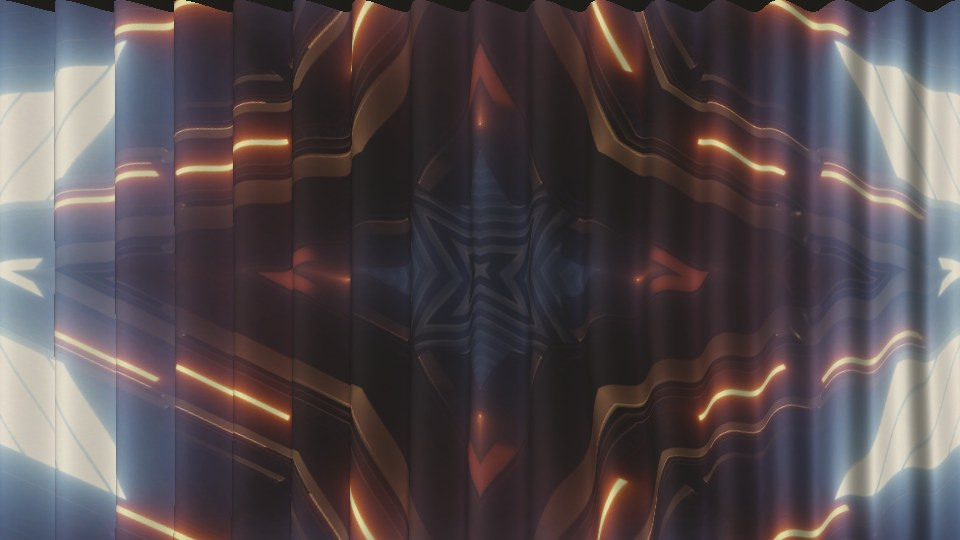

# throw

> **AI-assisted project.** This codebase was created with [Claude](https://claude.com/claude-code)
> (Anthropic), directed and reviewed by a human author. Its behaviour is measured rather
> than asserted: an offline harness drives the plugin's own class in a headless GL context
> and checks each claim against a model of its own, in double precision. A flat wall gives
> the clip back to 3e-7 from any projector and viewer position; every pixel of a tilted
> plane carries the inverse-square-and-cosine light its closed form says (worst
> 0.47 of its bound); a recess shows the picture where the parallax formula puts it,
> to 0.0007 px; a step's shadow is the closed-form length to within a pixel; the
> lens's highlight on zinc sits at the mirror point. 18 negative controls and
> 23 one-character mutants prove the checks can fail. Its Windows build has run in Resolume
> Arena on software rendering; it has **never been loaded into Resolume on macOS**. The full
> rundown is under [Status](#status).

A projector throwing your clip onto a real surface, as an FFGL effect for
[Resolume](https://resolume.com) Arena and Avenue: crumpled paper, a brick wall,
corrugated sheet, aluminium tread plate, pleated drapes, weatherboard, glazed tiles, or a
height map or photo of your own.



<sub>Rendered by `twtest`, the offline harness, not captured from Resolume. Resolume's
bundled `IntoTheGlow_02`, 1.67 s in, on Drapes at the defaults.</sub>

There's a [user guide](https://stoatworks-labs.com/software/throw/guide/), also as
[docs/USER-GUIDE.md](docs/USER-GUIDE.md).

<!-- downloads:start -->
<!-- downloads:end -->

## The one idea

**A projector is a lamp with a picture in it, and you are not standing at the lens.**

It is a projector, not a texture map. Every pixel of the clip is a ray leaving a lens at a
real place in the room. Where the ray meets the wall it brings light: as much as the
clip's pixel, times how squarely it meets the surface, over the square of how far it
travelled. The wall gives that light back in its own colour. And you are watching from
somewhere else, so you see each point of the relief from your own angle, not the
projector's.

Everything is at its real size. A brick is 215 by 65 mm with its joints raked 8 mm deep,
the corrugated sheet is 3-inch, 18 mm deep, and the drape's folds are half as deep as they
are apart. The wall is 2.5 m high in the frame unless you say otherwise.

## What falls out of it

Nothing below is drawn on. Each is what that one idea does.

- **The wall's colour.** Red brick eats the blue: a white clip comes back brick-red, and
  a blue one comes back dark. A projector adds light. It can't take away what the wall
  soaks up.
- **Shading by angle.** A face turned from the lens is dimmer by the cosine; one turned
  past 90° gets no projector light at all, only the room.
- **Shadows.** Relief between a point and the lens shadows it: the deep side of a
  corrugation, the far side of a drape fold, the bottom of a weatherboard's lip.
- **The picture slides over the relief.** Stand off to one side and the recesses are
  further away than the front, so the picture lands on them where the projector put it
  but you see it somewhere else. Straight lines kink across mortar joints and ripple over
  the folds. Stand at the lens and it all goes straight again, and the shadows vanish.
- **Metal throws back the lens.** The projector is a small, bright source, so galvanised
  sheet, tread plate and glazed tile show its reflection where the mirror puts it,
  coloured by whatever bit of the clip is aimed there, and it moves as you do.
- **No black.** A projector can't project black. Its own black level and the room's light
  are the floor, and the wall's texture shows through every dark part of the clip.
  Lumens, wall size and room lux set how much.
- **Keystone.** Point the projector at the wall from off-centre and the picture is a
  trapezoid, bright on the near side and dim on the far side. Lens Shift keeps it square
  and even, as a real shift lens does.


<sub>The clip, then Flat, Paper, Brick, Corrugated, Plate, Drapes, Weatherboard and Tiles,
everything else at the defaults: the viewer 2 m right of the lens and 0.8 m below the
frame's centre. The dark band along the top of Paper and Drapes is the room's light only:
from below, the viewer sees up into recesses past the top edge of the picture, where no
projector light lands.</sub>


<sub>The viewer walks past the drapes, level with the lens and as far back. From the lens
the picture is the clip, shaded by the folds and nothing else. Either side, it slides
over them.</sub>

## The surfaces

| Surface | What it is |
| --- | --- |
| **Flat** | A plain matte screen (gain 1.0). The reference: the clip comes back as it went in. |
| **Paper** | Crumpled paper: flat facets in up to four generations, each finer than the last, arriving as **Crumple** rises. 120 mm facets, ±15 mm. |
| **Brick** | UK metric brick, 215 × 65 mm, raked joints. **Bond**: Stretcher, English, Flemish, Stack. **Mortar**: joint width, 3–25 mm. Each brick its own colour, tilt and set. |
| **Corrugated** | Galvanised steel sheet (the light meets the zinc). **Profile**: Sine (3-inch corrugated) or Box (trapezoidal cladding). **Pitch**: 25–300 mm, depth in proportion. |
| **Plate** | Aluminium tread plate. **Pattern**: Diamond, Five-Bar, Crosshatch. 30 mm cells, 1.5 mm lugs. |
| **Drapes** | Pleated ivory cotton. **Pleats** across the frame; **Sag**: how slack it hangs, so the folds wander and deepen towards the floor. |
| **Weatherboard** | Painted feather-edge boards, 150 mm, each with a 15 mm lip at the bottom. |
| **Tiles** | White glazed metro tile, 200 × 100 mm, running bond, bevelled, 3 mm grout. |
| **File** | Your own **Surface File**. **File Holds** Height (grey: white at the front, black 100 mm back at Depth 1) or Photo (its colour the wall's, its brightness the height). A photo's darks aren't really its recesses, so Photo is a look, not a measurement. |

Metal's reflectance is worked out from published optical constants (zinc, Werner et al.
2009; aluminium, Rakić 1995), not picked by eye; `tools/f0.py` shows the sums.
**Roughness** sets how sharp the highlight is on metal and glaze.

## Controls

| Group | |
| --- | --- |
| **Surface** | Surface, Wall Height (how much wall the frame shows, 0.25–20 m), Scale (0.25–4× every surface's size), Depth (0–4× its real depth), Seed. |
| **Paper**, **Brick**, **Corrugated**, **Plate**, **Drapes** | Crumple; Bond, Mortar; Profile, Pitch; Pattern; Pleats, Sag. |
| **Finish** | Roughness (metal and glaze). |
| **File** | Surface File, File Holds. |
| **Projector** | Projector X and Y (±10 m from the frame's centre), Throw (1–50 m from the wall), Aim (Lens Shift, Pointed), Lumens (500–50 000), Black Level (0–2% of white). |
| **Room** | Ambient (0–1000 lux), Exposure (±4 stops). |
| **Viewer** | Viewer X and Y (±10 m), Viewer Distance (1–50 m). |
| **Output** | View (Picture, Height, Normals, Light, Shadow, Albedo), Mix. |

The defaults: a brick wall 2.5 m high in the frame; a 10 000 lumen projector a metre
above its centre at 6 m, lens shifted, with a 2000:1 black; a dim room (20 lux); and you,
2 m to the right of it and a little below, 4 m back.

**Depth** is the knob for drama. At its real depth a brick joint slides about two pixels
at 1080p from the default spot, which is what it really does. The Views show what the
plugin is working with: the relief, its normals, the projector's light alone, its shadow,
and the wall's colour.

Depth of field isn't modelled, because at real distances there's nothing to model: a
40 mm lens focused at 6 m blurs a 150 mm drape fold by about 1 mm, under half a pixel of a
2.5 m wall at 1080p.

## Status

**v0.1.0**, 2 November 2026, the first release. Measured offline on one Mac, and its
Windows build run in Resolume Arena by the fleet's Arena gate. It has **never been loaded
into Resolume on macOS**.

### Measured offline, on macOS

`tools/verify.sh` passes on this machine (Apple M4 Max, macOS 26.4.1) against a fresh
universal Release build. It runs every picture check at **two rasters**, 1280×720 and
320×180, and again on **Apple's software renderer** at 320×180. What it establishes:

| check | result |
| --- | --- |
| `--flat` | a flat wall under Lens Shift, three set-ups, lenses from (−4, 2.5, 2) to (6, −3, 10) m and viewers from (3, 0, 1.5) to (−7, 4, 20) m: the clip comes back within **3.0e-7** (bound 1e-5, the sRGB round trip's); brick at Depth 0 is the clip times brick, and pure blue gives the brick's blue, red and green 0 |
| `--lambert` | a white clip on three tilted planes under five projectors (left, right, above, close, pointed): every pixel, up to 838 525 of them, is d²·max(n·ω, 0)/(r²·cos³α) from the plane's closed-form hit, worst **0.47** of its per-pixel bound (1.9e-4 relative) |
| `--parallax` | a plateau 100 mm deep under 40 dots, four viewpoints: each dot within **0.0007 px** of a closed-form render (bound 0.02) and 0.0125 px of its centre's closed-form landing place; the floor's image slides **24.39 mm** per metre of viewer (closed form 24.39), 0.010 mm with the viewer at the lens |
| `--away` | a sawtooth whose ramps lean 76° from the wall, facing away from a lens 63° off it: on 416 520 of its pixels the clip (white, a card, black) changes **nothing**, and they hold 0.65 to 1.00 of the room's light |
| `--shadow` | a step 100 and 200 mm down: the shadow's far end is where R(x_e − C_x)/T puts it to within **0.69 px** in every row (bound 1); 0 of 13 320 shadowed pixels change with the clip |
| `--atlens` | the viewer at the lens, all seven procedural surfaces at Depth 1 and 4: **no shadow** at Depth 1 bar 4 brick pixels of 921 600; at Depth 4 a residual of 435 (brick), 60 (plate), 16 (tiles) and 8 (paper), within the stated 1e-3 (AGENTS.md says why) |
| `--hotspot` | flat zinc, lens and viewer mirror-symmetric about M, twice: the highlight's centroid is **0.0000 px** from M (bound 0.05), every pixel GGX with zinc's F0 within 2.8e-5; flat paper is bit for bit the same from three places |
| `--ambient` | five rooms (5–800 lux, 600–40 000 lm, walls 0.4–12 m, black levels, +1.5 and −2 stops): black and white come back as b + A and 1 + A, A = lux·W·H/lumens, within **8.6e-7**; a leaning plane gets all of the room's light within 1.6e-7 |
| `--keystone` | a pointed projector 2.5 m off-centre: 12 dots within **0.015 px** of the pinhole's place (bound 0.1); white on the trapezoid is g, 0.49 on the far side to 1.69 on the near, within 9.9e-7 |
| `--surfaces` | read off the surface buffer in metres: brick courses **75.00 mm**, bricks 225.00, stretcher half-bond 112.50, joints 9.2 mm for 10 (within a texel); English and Flemish bonds to their layouts; corrugation period **76.000 mm**, 17.97 mm deep (18.00), the sine within 1.6e-7 m; tread plate's 60 mm repeat; 8 and 21 pleats across the top; Crumple 0 flat |
| `--file` | 16-bit and 8-bit height maps come back within **9e-9 m**, a photo's albedo within 2.9e-8; a missing and a broken file are both Flat; Scale 0.5 tiles the map mirrored |
| `--dirty` | 17 surface controls changed on a running instance: each frame is a fresh instance's **bit for bit**; projector, viewer, room and output changes rebuild the surface 0 times |
| `--resize`, `--state` | a resize gives a fresh instance's frame bit for bit; the host's GL state comes back on all nine surfaces |
| `--units`, `--cues`, `--names` | 44 stated values and defaults, the room's sums and the pointed projector's basis, 0 wrong; 34 parameters, none over 16 bytes, no clashes |
| `--negative` | **18** deliberately wrong models, **18** caught |
| mutation | **23** one-character mutants of the shipped GLSL and C++, **23** caught |
| `tools/sweep.py` | all **29** controls measurably change the picture |
| shaders | all 4 compile through `glslc`, not only through Apple's driver; no trig built-ins, nothing WebGL2 lacks |
| the bundle | universal (`x86_64 arm64`), exports `plugMain`, ad-hoc signs; `oxbow` reports `SW Throw` / `TW01` / `effect` and renders 120 frames through `plugMain` |

Each bound is worked out from what can legitimately move a pixel: the sRGB functions'
few ulp, float rounding of the hit point, and the 8-bit weights of a GPU's texture filter.
Where a value decides something (a normal, a hit, the first texels of a shadow) the
plugin reads heights with float weights instead, which is why the light law holds to
1e-4 on a raster where the filter alone would put 1.8e-3 into it.

On Apple's software renderer the same checks pass, with two differences. The sRGB round
trip comes back within 7.6e-6 rather than 3.0e-7, inside the same 1e-5. And the renderer
doesn't repeat its own frames: the same input twice changes tens of thousands of values
in their last bits (up to 7e-5), so the frame-against-frame checks allow 1e-4 there and
report what they found.

### In Resolume, on Windows

The fleet's Arena gate ran the release workflow's own Windows build in Resolume Arena
7.27.1 on win-lab (Mesa llvmpipe, software rendering, no GPU), twice, with the same
result: the DLL loads, registers as `SW Throw` / `TW01`, an effect, and appears in
Arena's list; all 35 controls (Arena's Opacity and the plugin's 34) match their names,
order, types, ranges and defaults; it renders; and Arena's log stays clean: 10 passed,
0 failed, 0 skipped. Against a still, 28 of the 29 controls changed the picture, the
surface-specific ones under their own surface. Surface File is inconclusive, as a file
control always is there, but it took the gate's height map and File Holds then changed
the picture. Mesa compiled the shaders, so they are not only Apple's dialect. It says
nothing about speed on a GPU.

### Cost

Render cost, GPU time by `GL_TIME_ELAPSED`, median of 60 frames after 30 of warm-up, on
a GPU shared with other work, so the small numbers wobble from run to run: at the
defaults (Brick), **0.27 ms** at 720p, **0.47 ms** at 1080p and **2.03 ms** at 4K. Deeper
relief costs more, because the viewer's march takes two steps for every texel it travels:
Drapes is 0.48, 1.40 and 8.77 ms, Corrugated at Depth 4 is 0.37, 1.01 and 5.78 ms, and the
heaviest tried, Paper fully crumpled at Depth 4, is **0.71**, **2.07** and **13.04 ms**.

Those are for a still surface, which is only built when something it depends on changes.
Change a surface control and that frame rebuilds it: Paper with its Seed changed every
frame is 3.90, 8.37 and 33.47 ms. At 4K a surface control is for setting up, not for
automating at 60 fps. macOS figures only.

### Not established

It's **never been loaded into Resolume on macOS**: there it has only been measured
offline against the plugin's own class in a headless CGL context, plus an `oxbow` load.
On Windows it has run in Arena only on software rendering. Nobody has run it on a GPU
other than this Mac's, or with Resolume's own clips at 4K. There's a
[user guide](https://stoatworks-labs.com/software/throw/guide/), but no OpenFX port or
presets yet.

The model is a pinhole projector and a pinhole viewer, matte bodies with a GGX highlight
on metal and glaze, and the room's light uniform and white. There's no depth of field
(sub-pixel at real distances, above), no interreflection between facets, no projector
gamut or lamp colour. The surfaces' colours are chosen to look right, not measured; the
metals' reflectance is computed from published optical constants. A Photo's brightness
standing in for its relief is a look, not a measurement. AGENTS.md lists the rest.

## Browser demo

**<https://throw-demo.stoatworks-labs.com/>**: every surface, view and control with its own
name, group and default, on the kit's clips or your own, and a height map or photo of yours
as the Surface File (decoded in the page, never uploaded). The shaders are the plugin's own
GLSL, spliced unedited (`demo/tools/check_shaders.py`, run by `tools/verify.sh`); the CPU half
(the controls, the room in metres, the surface file) is a JavaScript port, and
`demo/tools/crosscheck/` renders it and `twtest` from the same card: in 22 cases across every
surface and view, no pixel is more than one level of 255 from the plugin's. It is a demo, not
the plugin, and says what it leaves out.

## Build

macOS (universal: Apple Silicon and Intel):

```bash
git clone --recurse-submodules https://github.com/stoatworks-labs/throw
```

```bash
cmake -B build -DCMAKE_BUILD_TYPE=Release
```

```bash
cmake --build build
```

```bash
cmake --install build
```

The last one copies `Throw.bundle` into `~/Documents/Resolume Arena/Extra Effects`.
Restart Arena and it's under Effects as **SW Throw**.

Windows needs Visual Studio 2022 and vcpkg (for GLEW); see `.github/workflows/ci.yml`,
which is the only place it has been built.

## Building and testing

```bash
tools/verify.sh
```

That's everything: a fresh universal build, every check at two rasters and on the
software renderer, the pipe, the negative controls, the mutants, the sweep for dead
controls, the metal table, the bundle's architecture and plist, an ad-hoc signature, a
host's view of it through `oxbow`, and the render cost. `CLAUDE.md` lists the checks one
by one.

Throw a picture of your own:

```bash
./build/twtest --out /tmp/throw.png --clip still.png --set "Surface=Corrugated" --set "Viewer X=0.2"
```

Or put a clip through it:

```bash
ffmpeg -i in.mov -vf fps=60 -f rawvideo -pix_fmt rgba - | ./build/twtest --pipe --size 1920x1080 --set "Surface=Drapes" | ffmpeg -f rawvideo -pix_fmt rgba -s 1920x1080 -r 60 -i - out.mp4
```

The figures here come from `tools/figures.py`.

## License

MIT. See [LICENSE](LICENSE) and [ATTRIBUTIONS.md](ATTRIBUTIONS.md).

<!-- attributions:start -->
This project is built on other people's work — see [ATTRIBUTIONS.md](ATTRIBUTIONS.md).
<!-- attributions:end -->
