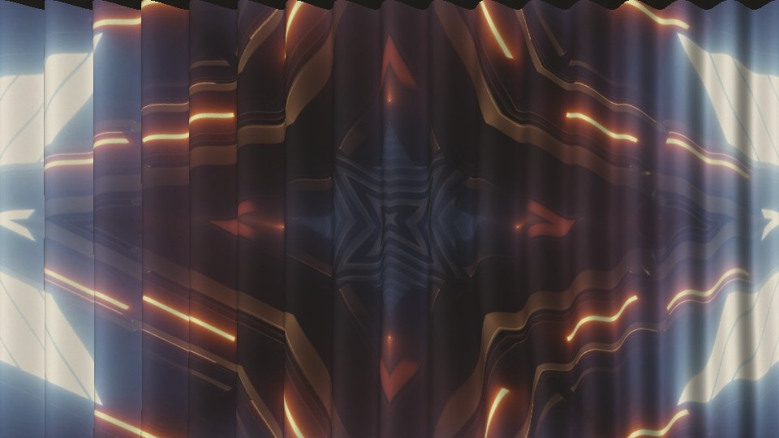
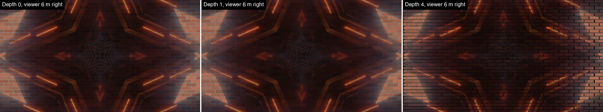

# Throw user guide

Throw is **a projector throwing your clip onto a real surface, for
[Resolume](https://resolume.com) Arena and Avenue**: one FFGL effect, **SW Throw**. Pick a wall
(crumpled paper, a brick wall, corrugated sheet, aluminium tread plate, pleated drapes,
weatherboard, glazed tiles, or a height map or photo of your own), put a projector somewhere in
the room, stand somewhere else, and the clip comes out the way it would on the night.

It's a projector, not a texture map. A texture map paints the picture onto the surface. Here every
pixel of the clip is a ray of light leaving a lens at a real place in the room. Where the ray meets
the wall it brings light: as much as the clip's pixel, times how squarely it meets the surface,
over the square of how far it travelled. The wall gives that light back in its own colour. And
you're watching from somewhere else, so you see each bit of the relief from your own angle, not
the projector's. Everything in this guide is what that one idea does.



*Rendered by `twtest`, the offline harness, rather than captured from Resolume: Resolume's bundled
IntoTheGlow_02, 1.67 s in, on Drapes with everything else at the defaults, at 1280×720.*

> **Before you rely on this:** it's at **v0.1.0**, the first release, and very early days. Its
> behaviour is measured rather than asserted, by a harness (`twtest`) that drives the plugin's own
> class in a headless GL context on one Apple Silicon Mac (macOS 26), at 1280×720 and 320×180 and
> again on Apple's software renderer. A flat wall gives the clip back to within 3e-7 from any
> projector and viewer position. Every pixel of a tilted plane carries the inverse-square and
> cosine light its closed form says (the worst is 0.47 of its bound). A recess shows the picture
> where the parallax formula puts it, to 0.0007 px; a step's shadow is the length the geometry
> says to within a pixel; the lens's highlight on zinc sits at the mirror point. Eighteen models
> that are wrong on purpose and 23 one-character changes to the shipped code are all caught, and
> all 29 controls measurably change the picture.
> It's **never been loaded into Resolume on macOS**. The one host it has run in on a Mac is the
> fleet's own test host, `oxbow`, for 120 frames, so on a Mac nobody has seen its controls in
> Arena's inspector or what Resolume's own clips at 4K do to the frame rate.
> On **Windows** it has been built by CI (Visual Studio 2022, x64) and not yet loaded into
> Resolume.
> Try it on a spare layer before you put it in a show.
>
> This codebase was created with AI assistance, directed and reviewed by a human author.

---

## Installing

Every download carries one effect, **SW Throw** (`Throw.bundle` on macOS, `Throw.dll` on
Windows). Drop it into Resolume's effects folder and restart Resolume:

```
macOS    ~/Documents/Resolume Arena/Extra Effects/
Windows  %USERPROFILE%\Documents\Resolume Arena\Extra Effects\
```

Avenue uses the same layout under its own folder name. The effect then shows up in the effects
browser as **SW Throw**.

The macOS download is a universal build (Apple silicon and Intel), as a `.dmg` or a `.zip`. It's
**Developer ID-signed and notarised**, so the bundle just loads. The Windows download is an x64
installer or a `.zip`. The installer asks which folder to put the plugin in: give it the one
above. It isn't code-signed, so it trips SmartScreen once: **More info** → **Run anyway**. Or skip
the installer, take `Throw.dll` out of the `.zip` and drop it into the folder by hand.

---

## Start here

Put SW Throw on a layer with something in it and leave every control where it is. The defaults
are a brick wall 2.5 m high in the frame, a 10 000 lumen projector a metre above its centre and
6 m back, a dim room, and you standing 2 m to the right of the projector, a little below it and
4 m from the wall. The clip comes out brick-coloured, with the brick showing through its darks.

Then, in this order:

1. **Depth** all the way up. The joints are four times their real depth now, and the picture
   steps where it crosses them, because you're not standing at the lens.
2. Stand at the lens: **Viewer X** 0.5, **Viewer Y** 0.66 and **Viewer Distance** 0.46, which are
   the projector's own X, Y and Throw. The steps go, and so do the shadows: from the lens the
   relief only shades the picture. Move **Viewer X** either side and they come back, leaning the
   other way.
3. **Surface** to **Drapes**. Pull **Viewer X** about and watch the picture slide over the folds.
   **Pleats** and **Sag** change the cloth.
4. **Surface** to **Corrugated** or **Plate**. There's a bright patch where the sheet throws back
   the lens, coloured by whatever bit of the clip is aimed there. Move the viewer and it moves.
5. **Ambient** up. The room's light washes in, and the clip's blacks turn into the wall.
6. **Aim** to **Pointed** and **Projector X** off to one side. The picture becomes a trapezoid,
   brighter on the near side.
7. **View** through **Height**, **Normals**, **Light**, **Shadow** and **Albedo** to see what the
   plugin is working with, then back to **Picture**.

---

## A projector, not a texture map

Everything below falls out of the one idea. None of it is drawn on.

- **The wall's colour.** Red brick eats the blue: a white clip comes back brick-red, and a blue one
  comes back dark. A projector adds light. It can't take away what the wall soaks up.
- **Shading by angle.** A face turned from the lens is dimmer by the cosine of the angle. One
  turned past 90° gets no projector light at all, only the room's.
- **Shadows.** Relief between a point and the lens shadows it: the deep side of a corrugation, the
  far side of a drape fold, the strip under a weatherboard's lip.
- **The picture slides over the relief.** Stand to one side and the recesses are further away than
  the front, so the picture lands on them where the projector put it but you see it somewhere
  else. Straight lines kink across mortar joints and ripple over folds. Stand at the lens and it
  all goes straight again, and the shadows go too: from the lens you can't see a shadow the lens
  casts.
- **Metal throws back the lens.** The projector is a small, bright source, so galvanised sheet,
  tread plate and glazed tile show its reflection where the mirror puts it. It moves as you do.
- **No black.** A projector can't project black. Its own black level and the room's light set the
  floor, and the wall shows through every dark part of the clip.
- **Keystone.** Point the projector at the wall from off-centre and the picture is a trapezoid,
  bright on the near side and dim on the far side. Lens Shift keeps it square and even, as a real
  shift lens does.

Everything is at its real size, in metres. A brick is 215 by 65 mm with its joints raked 8 mm deep,
the corrugated sheet is 3-inch, 18 mm deep, and a drape's folds are half as deep as they are apart.
That's honest, and it's subtle: at its real depth a brick joint slides about two pixels at 1080p
from the default spot, which is what it really does. **Depth** is the knob for drama.


*The clip, then Flat, Paper, Brick, Corrugated, Plate, Drapes, Weatherboard and Tiles, everything
else at the defaults. The dark band along the top of Paper and Drapes is the room's light only:
from below, you see up into recesses past the top edge of the picture, where no projector light
lands.*

---

## The Surface group

Hosts show slider positions, not metres, so this guide gives each control's range and where its
default sits on the slider.

| Control | What it does | Range | Default |
| --- | --- | --- | --- |
| **Surface** | Which wall: Flat, Paper, Brick, Corrugated, Plate, Drapes, Weatherboard, Tiles or File. | | Brick |
| **Wall Height** | How much wall the frame shows, top to bottom. The width follows the frame's shape. | 0.25–20 m, evenly in ratio | 2.5 m (0.53) |
| **Scale** | Every surface's size, bricks, folds and all. | 0.25–4× | 1× (the middle) |
| **Depth** | Every surface's depth, from flat to four times real. | 0–4×, finer near 0 | 1× (the middle) |
| **Seed** | The surface's random variation: each brick's colour, tilt and set, the paper's creases, the cloth's wander, the grain. | 0–99 | 1 |

| Surface | What it is |
| --- | --- |
| **Flat** | A plain matte screen with a gain of 1. The reference: the clip comes back as it went in, give or take the room. |
| **Paper** | Crumpled paper: flat facets in up to four generations, each finer than the last, arriving as **Crumple** rises. 120 mm facets, ±15 mm. |
| **Brick** | UK metric brick, 215 × 65 mm, raked joints. Each brick its own colour, tilt and set. |
| **Corrugated** | Galvanised steel sheet: the light meets the zinc. |
| **Plate** | Aluminium tread plate, 30 mm cells, 1.5 mm lugs. |
| **Drapes** | Pleated ivory cotton, the folds wandering and deepening towards the floor. |
| **Weatherboard** | Painted feather-edge boards, 150 mm, each with a 15 mm lip at the bottom. |
| **Tiles** | White glazed metro tile, 200 × 100 mm, running bond, bevelled, 3 mm grout. |
| **File** | Your own **Surface File**: see *The File group*. |

### The surfaces' own controls

Each of these only acts on its own surface.

| Group | Control | What it does | Range | Default |
| --- | --- | --- | --- | --- |
| **Paper** | **Crumple** | How crumpled: the big folds first, then smaller ones inside them. | 0–1 | 0.7 |
| **Brick** | **Bond** | Stretcher, English, Flemish or Stack. | | Stretcher |
| | **Mortar** | Joint width. | 3–25 mm, even | 10 mm (0.32) |
| **Corrugated** | **Profile** | Sine (3-inch corrugated) or Box (trapezoidal cladding). | | Sine |
| | **Pitch** | The repeat; the depth goes with it. | 25–300 mm, evenly in ratio | 76 mm (0.45) |
| **Plate** | **Pattern** | Diamond, Five-Bar or Crosshatch. | | Diamond |
| **Drapes** | **Pleats** | How many folds across the frame. | 2–60 | 16 |
| | **Sag** | How slack the cloth hangs, so the folds wander and deepen lower down. | 0–1 | 0.3 |
| **Finish** | **Roughness** | How sharp the highlight is on metal and glaze. Matte surfaces ignore it. | 0.05–0.8 | 0.35 (0.4) |

The metals' reflectance is worked out from published optical constants (zinc, Werner et al. 2009;
aluminium, Rakić 1995), not picked by eye.

### The File group

| Control | What it does |
| --- | --- |
| **Surface File** | A picture of your own, used when **Surface** is **File**: PNG at 8 or 16 bits, JPEG, TGA or BMP. |
| **File Holds** | **Height**: the picture is a height map, grey, white at the front and black 100 mm back at Depth 1. **Photo**: the picture is a photo of a wall, its colour the wall's and its brightness the height. |

The file spans the frame at Scale 1. Below 1 it repeats, mirrored so there's no seam. A 16-bit
height map keeps its precision all the way through. A missing or unreadable file gives you Flat,
and the reason is in the log.

Photo is a look, not a measurement: a photo's darks aren't really its recesses. For a real wall, a
height map from a scan or a depth camera is the honest input.

---

## The Projector group

| Control | What it does | Range | Default |
| --- | --- | --- | --- |
| **Projector X**, **Projector Y** | Where the lens is, left-right and up-down from the frame's centre. | ±10 m, finer near the middle | 0 m and 1 m above (0.5 and 0.66) |
| **Throw** | How far the lens is from the wall. | 1–50 m, evenly in ratio | 6 m (0.46) |
| **Aim** | **Lens Shift**: the lens faces the wall square on and its picture is shifted to fill the frame, as a projector with a shift lens does. **Pointed**: the projector is turned to aim at the frame's centre, so from off-centre the picture is keystoned. | | Lens Shift |
| **Lumens** | How bright the projector is. Against the room, that's what decides how well the clip holds up. | 500–50 000, evenly in ratio | 10 000 (0.65) |
| **Black Level** | What the projector gives for black, as a fraction of its white. | 0–2%, finer near 0 | 0.05%, 2000:1 (0.16) |

The light at each point is d²·cos θ / (r²·cos³α), relative to a flat screen at the throw: the
inverse-square and cosine laws for a projector built to light its design screen evenly. On a flat
wall with Lens Shift that's exactly 1 everywhere, so the clip comes back as it went in. Anything
nearer the lens gets more and anything turned from it gets less.


*Left, Flat with the projector 2.5 m left of centre on Lens Shift. Middle, the same on Pointed.
Right, Brick at the defaults with Ambient at 400 lux.*

---

## The Room group

| Control | What it does | Range | Default |
| --- | --- | --- | --- |
| **Ambient** | The room's own light on the wall, even from every direction: it reaches every face, turned from the lens or not, and less of it gets into deep recesses. | 0–1000 lux, finer near 0 | 20 lux, a dim room (0.14) |
| **Exposure** | The whole picture up or down, as a camera would expose for it. | ±4 stops | 0 (the middle) |

The room's light against the projector's is lux × wall width × wall height ÷ lumens, so a bigger
wall or a dimmer projector shows more of the room. With the defaults, a 4.4 × 2.5 m wall at 20 lux
under 10 000 lumens, the floor is a little over 2% of white. A projector at 2000 lumens in a 200 lux
room loses most of its contrast, as it would.

---

## The Viewer group

| Control | What it does | Range | Default |
| --- | --- | --- | --- |
| **Viewer X**, **Viewer Y** | Where you're standing, left-right and up-down from the frame's centre. | ±10 m, finer near the middle | 2 m right and 0.8 m below (0.72 and 0.36) |
| **Viewer Distance** | How far you are from the wall. | 1–50 m, evenly in ratio | 4 m (0.35) |

The frame always shows the same rectangle of wall, wherever you stand: the viewer has a shift
lens too. What changes is which bit of the relief you see each point of the picture on. Put the
viewer exactly where the projector is (the same X, Y and distance as the projector's X, Y and
Throw) and the picture lies on the relief with no slide and no shadow, shaded by the surface and
nothing else.



*Brick with the viewer 6 m right of centre, at Depth 0, 1 and 4.*


*The viewer walks past the drapes, level with the lens and as far back. From the lens the picture
is the clip, shaded by the folds and nothing else. Either side, it slides over them.*

Viewer X is the one to animate: give it a slow LFO and the wall turns into a set you're walking
past.

---

## The Output group

| Control | What it does |
| --- | --- |
| **View** | **Picture**, or what the plugin is working with: **Height** (the relief, white at the front), **Normals** (which way each bit faces), **Light** (the projector's light alone, shading and shadows, no colour), **Shadow** (white where the lens can see, black where it can't), **Albedo** (the wall's own colour). |
| **Mix** | Blends between the clip as it came in (0) and the thrown picture (1). |


*Weatherboard with the projector 6 m above centre and 2.5 m back, in each View.*

At Mix 1 the output is opaque: the thrown picture fills the frame, wall and all, whatever the
clip's alpha.

---

## Recipes

Slider positions in brackets.

- **A gig on a warehouse wall.** Brick, Bond English, Depth 2 (0.71), Lumens 5000 (0.5),
  Ambient 60 lux (0.24). Viewer X slowly back and forth.
- **Theatre drapes.** Drapes, Pleats 24, Sag 0.6, the projector 3 m to the left (Projector X
  0.23) so one side of every fold is lit and the other falls into shadow, and the viewer in the
  stalls (Viewer Y −1 m, 0.34; Viewer Distance 10 m, 0.59).
- **Shed at night.** Corrugated, Profile Box, Roughness 0.2 (0.2), Ambient 0, the viewer 3 m to
  the left (Viewer X 0.23): dark steel with the lens glinting off the ribs.
- **Crumpled flyer.** Paper, Crumple 1, Depth 2 (0.71), Ambient 100 lux (0.32): pale paper with
  the clip printed on it.
- **A projector on a stand.** Flat, Aim Pointed, Projector Y −1.5 m (0.31), Throw 3 m (0.28): the
  picture spreads as it climbs the wall, as a projector tilted up at it does.
- **Your own wall.** A greyscale height map of a real wall as the Surface File and File Holds on
  Height. At Depth 1 (0.5) black is 100 mm behind white; set Depth to the map's own range over
  100 mm for its real depth.

---

## Performance

Measured by the offline harness on an Apple Silicon Mac: GPU time by `GL_TIME_ELAPSED`, median of
120 frames after a warm-up, on a GPU shared with other work, so the small numbers wobble from run
to run.

| | 720p | 1080p | 4K |
| --- | --- | --- | --- |
| the defaults (Brick) | 0.27 ms | 0.47 ms | 2.03 ms |
| Drapes | 0.48 ms | 1.40 ms | 8.77 ms |
| Corrugated at Depth 4 | 0.37 ms | 1.01 ms | 5.78 ms |
| Paper, Crumple 1, Depth 4 (the heaviest tried) | 0.71 ms | 2.07 ms | 13.04 ms |
| Seed changing every frame, so the wall is rebuilt every frame | 3.90 ms | 8.37 ms | 33.47 ms |

The wall is built once and kept: everything in the Surface, Paper, Brick, Corrugated, Plate,
Drapes, Finish and File groups decides the wall, and changing any of them rebuilds it. The
projector, room, viewer and output controls don't, so **animate those freely and leave the
surface's controls still**. Animating Seed or Crumple rebuilds the wall every frame, which at 4K
is about two 60 fps frames' worth. Deep relief costs more than shallow, because each pixel looks
further along its ray. These are macOS figures from the harness; nothing was timed inside
Resolume.

---

## If it looks wrong

**The effect does nothing at all.** That's what a shader that won't compile looks like. The actual
error is in the log:

```
macOS    ~/Library/Logs/throw/throw.YYYY-MM-DD.log
Windows  %LOCALAPPDATA%\throw\logs\throw.YYYY-MM-DD.log
```

It records the build, the GL vendor, renderer and version at load, which shader failed if one did,
and why a Surface File didn't load.

**It isn't in the effects browser.** Check the folder under *Installing*, including the one you gave
the Windows installer, and that Resolume was restarted.

**I can't see the relief.** At its real depth it's subtle, as a real wall is from a few metres: turn
up **Depth**, move the viewer away from the projector, or try Drapes.

**A control does nothing.** The surface's own controls only act on their own surface (Crumple on
Paper, Bond on Brick, and so on), and Roughness only on metal and glaze. Surface File does
nothing until Surface is File.

**The clip looks washed out.** That's the room: Ambient is high for the projector's Lumens or the
wall's size. Lower Ambient, raise Lumens or make the wall smaller with Wall Height.

**The clip's colours are wrong.** That's the wall's colour, as on a real wall. Brick eats blue.
Flat, Tiles or Drapes keep the clip's colours closest.

**A dark band along the top or bottom.** You're looking into recesses past the edge of the
picture, where no projector light lands, so they get the room's light only. It goes as the viewer
comes level with the projector.

**Black wedges round the picture.** Aim is Pointed and the projector is off-centre: that's the
keystone. Lens Shift fills the frame.

**The frame rate drops when I animate.** You're animating a surface control: see *Performance*.

**The Surface File didn't load.** The log says why. The path must be one Resolume can read, and the
file a PNG, JPEG, TGA or BMP.

**The layer under it has gone.** The output is opaque. Use a blend mode, or Mix.

---

## Known limits

- **Never loaded into Resolume on macOS.** How the 29 controls in twelve groups read in Arena's
  inspector on a Mac is untested.
- **The inspector shows slider positions**, not metres, lumens or lux. This guide gives the ranges,
  and where the defaults sit.
- **A pinhole projector and a pinhole viewer.** No depth of field: at real distances there's
  nothing to model (a 40 mm lens focused at 6 m blurs a 150 mm drape fold by about 1 mm, under half
  a pixel of a 2.5 m wall at 1080p).
- **One bounce.** Light from the projector reaches the wall and comes back to you. It doesn't bounce
  between the folds or off the floor.
- **The room's light is even and white**, and the projector has no colour of its own: no lamp
  colour and no gamut.
- **The surfaces' colours are chosen to look right**, not measured. The metals' reflectance is
  computed from published optical constants.
- **sRGB in, sRGB out.** The plugin takes what Resolume hands it as sRGB-encoded and turns it into
  light. A host handing over linear light would have it lit twice over.
- **A heightfield.** Every surface is a height at each point of the wall, so nothing overhangs: a
  drape can't fold back over itself.
- **One projector.**
- **No presets** (Resolume saves parameter presets itself) and no OpenFX version.

---

## About

The last group, **About**, has the plugin's name, version, licence and maker, and buttons that open
this user guide, the project page, the source on GitHub and the support page in your browser.

## Reporting something

If something's wrong, shout at
[github.com/stoatworks-labs/throw/issues](https://github.com/stoatworks-labs/throw/issues). A
screenshot, the Surface and any controls you changed, and the composition's resolution and frame
rate are usually enough. If the effect drew nothing, or a Surface File didn't load, attach the
log.

The FFGL SDK, GLEW and stb_image it's built on, and the published measurements behind the metals,
are credited in
[ATTRIBUTIONS.md](https://github.com/stoatworks-labs/throw/blob/main/ATTRIBUTIONS.md), which
travels with the plugin.
